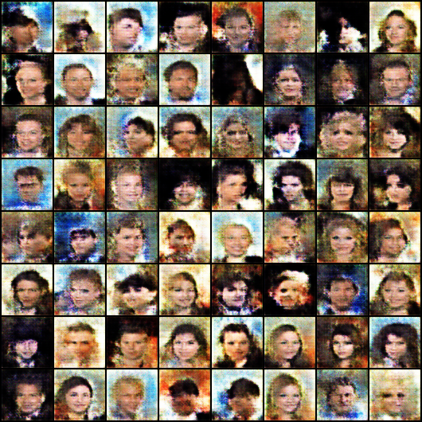
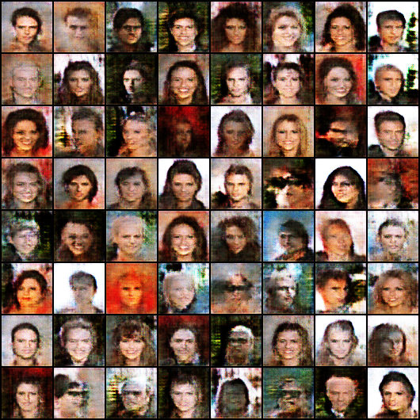
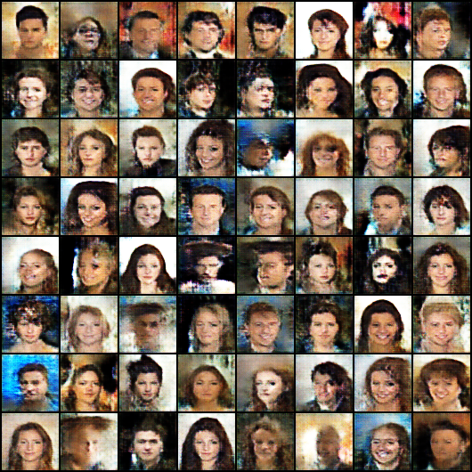
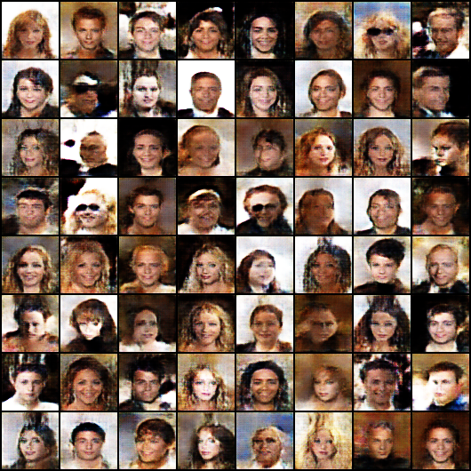

# Deep Metric Learning 실험 모음 (PyTorch)

Metric learning 손실 함수가 임베딩 공간을 어떻게 구성하는지, 그리고 그 학습된 metric을
생성 모델의 학습 신호로 쓸 수 있는지를 실험한 코드입니다.

두 갈래로 구성되어 있습니다.

| 갈래 | 위치 | 내용 |
|---|---|---|
| **1. 임베딩 공간 실험** | 루트 `*.py` | MNIST에 Triplet / SubCenterArcFace 손실을 적용하고 임베딩을 저차원 투영해 비교 |
| **2. Manifold Matching GAN** | `pytorch-manifold-matching/` | 학습된 metric을 GAN 생성자의 목적함수로 사용 (ICCV 2021 재현 및 확장) |

<p align="center">
  
  
  
  
</p>
<p align="center"><i>CelebA 64×64, epoch 20 / 40 / 60 / 80 생성 샘플</i></p>

## 1. 임베딩 공간 실험

| 파일 | 손실 함수 | 요약 |
|---|---|---|
| `MNIST_using_TripletMarginLoss.py` | `TripletMarginLoss` | 거리 기반. 마이너로 semi-hard 쌍을 뽑아 학습 |
| `MNIST_using_SubCenterArcFaceLoss.py` | `SubCenterArcFaceLoss` | 분류 기반. 클래스당 sub-center를 두어 각도 마진 부여 |
| `Model.py` | – | 두 실험이 공유하는 MLP 임베딩 헤드 |

두 스크립트 모두 학습 후 임베딩을 **MDS / Isomap / t-SNE** 세 방식으로 투영해
클러스터 분리 양상을 그림으로 비교합니다. 정량 평가는
`pytorch_metric_learning`의 `AccuracyCalculator`(Precision@1 등)를 사용합니다.

```bash
pip install -r requirements.txt
python MNIST_using_TripletMarginLoss.py       # MNIST는 자동 다운로드됩니다
python MNIST_using_SubCenterArcFaceLoss.py
```

## 2. Manifold Matching GAN

[dzld00/pytorch-manifold-matching](https://github.com/dzld00/pytorch-manifold-matching)
(*Manifold Matching via Deep Metric Learning for Generative Modeling*, ICCV 2021)을
기반으로, 학습 루프와 비교 실험을 덧붙인 버전입니다.

**원본에서 바꾼 부분**

- `train.py` — TensorBoard 로깅(`SummaryWriter`) 추가, `--load_model_path`로 체크포인트 재개,
  이미지 리사이즈 종횡비 버그 수정, 명시적 import로 정리
- `data_utils.py` — `requires_grad()` 헬퍼 추가, `Resize`에 `(size, size)` 지정
- `gan.py`, `model_gan.py` — **새로 추가.** metric loss 없이 학습하는 vanilla GAN 베이스라인.
  manifold matching 목적함수의 기여분을 분리해 보기 위한 대조군입니다
- `implementation-stylegan2/` — StyleGAN2 백본에 MvM 목적함수를 얹은 변형

```bash
cd pytorch-manifold-matching
python train.py --data_path <CelebA 경로> --size 64   # manifold matching
python gan.py   --data_path <CelebA 경로> --size 64   # 베이스라인 GAN
tensorboard --logdir results
```

CelebA는 [공식 배포처](https://mmlab.ie.cuhk.edu.hk/projects/CelebA.html)에서 받아
`--data_path`로 지정하세요. 데이터셋과 체크포인트는 저장소에 포함하지 않습니다.

## 후속 작업

이 저장소의 manifold matching 실험은 별도 저장소에서 이어집니다 —
[**pytorch_MVM**](https://github.com/jwlee3746/pytorch_MVM) (목적함수 자체를 수정한 MVM+).

## 라이선스 및 출처

- `pytorch-manifold-matching/`은 [dzld00/pytorch-manifold-matching](https://github.com/dzld00/pytorch-manifold-matching)에서 파생했으며, 원본 라이선스를 따릅니다.
- 임베딩 실험은 [KevinMusgrave/pytorch-metric-learning](https://github.com/KevinMusgrave/pytorch-metric-learning) (MIT) v1.3.0을 사용합니다.
  이전에는 이 라이브러리 소스를 저장소에 복사해 두었으나, 지금은 `requirements.txt`의 의존성으로 설치합니다.
